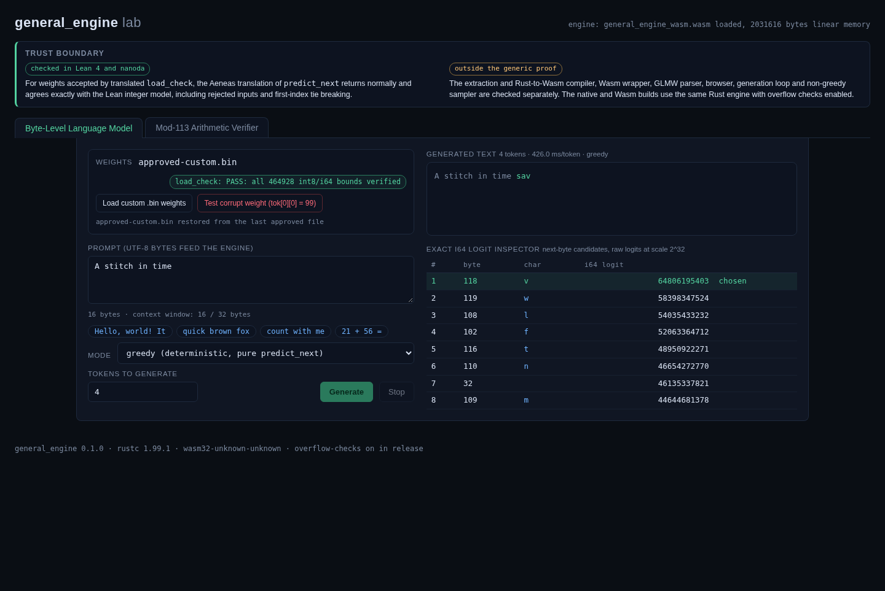
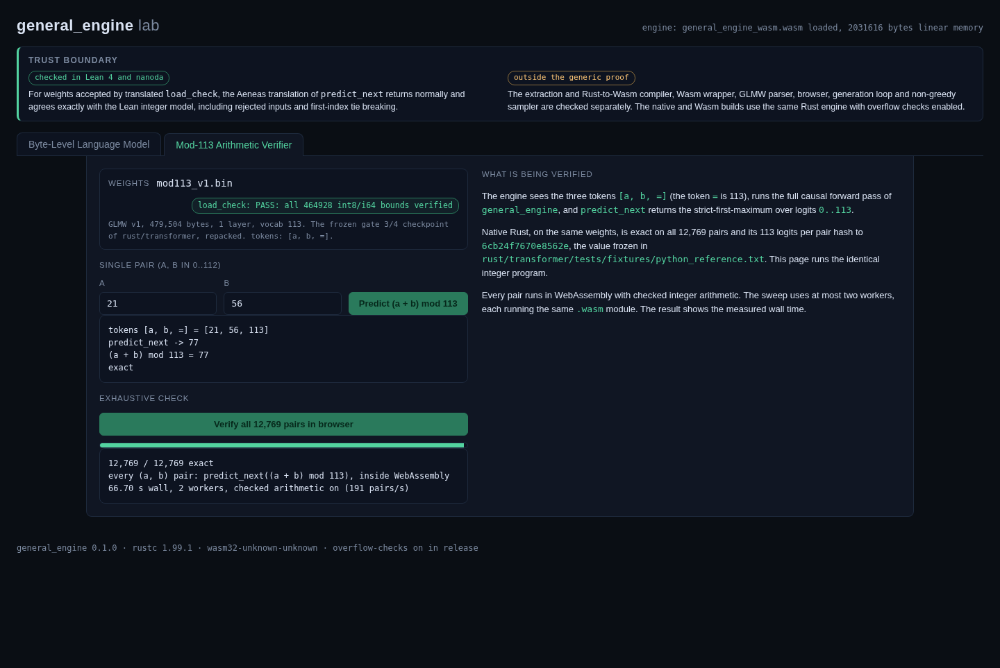

# lean-checked-network-exec

A universal integer transformer inference engine in safe Rust (`578` lines), translated to Lean 4 with Charon and Aeneas, proved in Lean 4 to match its mathematical specification without panics or integer overflow for **every** weights file passing its bounds check, independently rechecked by `nanoda_bin`, and compiled unchanged to WebAssembly to run a trained byte-level language model and a mod-113 transformer in the browser.

Link 2 of [teal-sea/lean-checked-network](https://github.com/teal-sea/lean-checked-network): carrying kernel-checked neural network theorems from abstract Lean specifications to executable Rust code running outside Lean.

## In short

- **One theorem for the engine, not one model at a time ([E4](E4-REPORT.md)):** `LcnExec.GeneralEngine.general_engine_correct` proves that for every `Weights` accepted by the translated Rust `load_check` (1 or 2 causal layers, vocabulary up to 256, context up to 32) and every token array and length, `predict_next` returns `ok` (excluding panics, overflow, out-of-bounds access, and divergence in Aeneas semantics) and agrees exactly with `GeneralModel.predictNext`. `forward_logits_spec` additionally proves exact equality of all 256 ordered `i64` logits.
- **Two independent kernels checked it:** Lean 4.35.0 (`lake build`, direct elaboration, typed import, `leanchecker --fresh`) accepted the theorem using **only** Lean's standard axioms (`propext`, `Classical.choice`, `Quot.sound`; zero `sorry`, zero `native_decide`). Independently implemented Rust kernel **`nanoda_bin` 0.4.19** checked **9,261 declarations** with zero typechecker errors ([E4 receipt](evidence/e4-general-engine/RECEIPT.json); the 55.7 MB `general_engine_correct.ndjson` export is attached to the [e4-general-engine-evidence release](https://github.com/teal-sea/lean-checked-network-exec/releases/tag/e4-general-engine-evidence)).
- **Mutation controls reject broken Rust:** Fresh Charon/Aeneas extraction of unmodified `rust/general_engine/src/lib.rs` matched the frozen translation byte for byte. Three isolated Rust bugs (`shift` 15 vs 16, attention scale `2^23` vs `2^24`, and last-on-tie argmax) all compiled natively with overflow checks, changed native output, and were **rejected by the unchanged Lean proofs** after re-extraction.
- **Two real checkpoints run on the exact proved crate ([E5](E5-REPORT.md), [E6](E6-REPORT.md)):**
  - `weights/mod113_v1.bin` (1-layer transformer): **12,769 / 12,769** exact in Python, native Rust, and browser WebAssembly (66.70 s in Chromium with 2 workers and checked arithmetic; logit FNV-1a hash `6cb24f7670e8562e` matches the pinned fixture).
  - `weights/tiny_bytelm_v1.bin` (2-layer byte LM, 464,128 params): 1.3866 bits/byte (exact integer matches float QAT to 4 decimals, logit correlation `1.000000`), **0 mismatches** across 51,200 logits between Rust and Python and all 256 browser Wasm logits. Corrupt 1-byte weight uploads fail `load_check` and disable generation until restored.
- **Explicit scope limits:** The Lean proof covers the translated safe Rust engine (`rust/general_engine/src/lib.rs`) under Aeneas semantics against the frozen Lean specification. It does **not** verify `rustc`, LLVM, the WebAssembly wrapper, the binary file parser (`GLMW v1`), the browser runtime, or model text quality. The original under-1-second stretch target for the browser mod-113 sweep was not met (66.70 s with checked arithmetic; no unchecked or lookup shortcut was substituted).

Full reports: [E4 (engine proof)](E4-REPORT.md) · [E5 (reference, byte LM, parity)](E5-REPORT.md) · [E6 (Wasm browser demo)](E6-REPORT.md) · [STATUS.md](STATUS.md) · [PLAN.md](PLAN.md).

## Browser WebAssembly demo

| Trained 2-layer byte LM (`tiny_bytelm_v1.bin`) | Full 12,769-pair mod-113 sweep (`mod113_v1.bin`) |
| :---: | :---: |
|  |  |

Run it locally with no remote dependencies or API keys (`evidence/e6-wasm/package.sha256` pins the bundle):

```sh
unzip evidence/e6-wasm/private-local-page.zip -d /tmp/lcn-demo
cd /tmp/lcn-demo
node scripts/e6_browser_replay.js --serve 8765
# Open http://127.0.0.1:8765/web/index.html
```

Click **Generate** to run the 2-layer byte LM on the proved Wasm engine, click **Test corrupt weight** (or upload `evidence/e6-wasm/fixtures/qa-invalid.bin`) to see `load_check` reject an out-of-range weight and restore cleanly, or switch to **Mod-113 Arithmetic Verifier** to run all 12,769 pairs.

## Audit surface (E4 general engine)

Exact line counts of the verified crate, its Aeneas translation, and the Lean 4 proof modules ([E4 receipt](evidence/e4-general-engine/RECEIPT.json) records SHA-256 hashes for every file):

| Component | Path | Files | Lines | Role |
| --- | --- | ---: | ---: | --- |
| Safe Rust inference engine | `rust/general_engine/src/lib.rs` | 1 | 578 | Checked `i64` causal transformer + `load_check` |
| Charon + Aeneas translation | `lean/LcnExec/Translated/GeneralEngine.lean` | 1 | 2,019 | Generated pure-functional Lean model of the Rust crate |
| Specification & proofs | `lean/LcnExec/GeneralEngine/*.lean` | 32 | 6,472 | `Model.lean` (285), `Load.lean` (703), `Primitives.lean` (602), `Softmax.lean` (575), layer/attention/MLP/unembed/argmax/entrypoint proofs (`Correct.lean`: 202) |
| **Total** | | **34** | **9,069** | |

## Trusted tools

All pins are recorded in [toolchain/PINS.md](toolchain/PINS.md) and bound by SHA-256 in the gate receipts:

| Tool | Pinned version / commit | Role |
| --- | --- | --- |
| Lean 4 | `leanprover/lean4:v4.35.0` (`eb6cafb7`) | Primary theorem prover and kernel (`leanchecker --fresh`) |
| Mathlib | `v4.35.0` (`56a00585`) | Proof library (`lean/lake-manifest.json`) |
| `nanoda_bin` | `0.4.19` (sha256 `cbf13950...`) | Independent Rust Lean typechecker (9,261 decls checked for E4) |
| `leanexport` | `3.1.0` (sha256 `f6a6483d...`) | Theorem dependency-closure exporter for `nanoda_bin` |
| Charon | `0.1.308` (`a58d1592`) | Rust MIR-to-LLBC extractor |
| Aeneas | `nightly-2026.11.04-d1e177b` (`d1e177bb`) | LLBC-to-Lean 4 functional translator |
| Rust (`rustc`) | `1.99.1` (`rust/rust-toolchain.toml`) | Production native & WebAssembly compiler (`overflow-checks = true`) |
| Chromium | `156.0.8078.79` | Browser Wasm integration verification (`evidence/e6-wasm/ACCEPTANCE.json`) |

## Earlier verified gates in this repository

- **Gate 1A (Rust RNN adder):** Safe Rust `rust/adder` proved equal to `RnnAdder` across 10 theorems (`LcnExec.Adder.Proofs`), checked by Lean + `nanoda_bin` (14/14 theorems), 0 mismatches across 3,535 compile-and-diff inputs, planted faults caught.
- **Gate 4 (fixed-width integer transformer):** `TransformerInt.Gen.adds_mod_113` proved for all 12,769 pairs in 136 Lean modules (replayed across 135/135 import-closure modules by `leanchecker`).
- **Aristotle Rust evaluations (1R, MLP-R, 5R):** Retained provider receipts in `evidence/aristotle/` for the Rust adder (5/5 proved), MLP + `unsafe` twin (5/5 proved), and mod-113 transformer (3/3 proved). Because Aristotle returns summaries and Lean property statements without replayable proof sources, the Aeneas + Lean + `nanoda_bin` track above remains the independently replayable proof route.

## Layout

| Path | Contents |
| --- | --- |
| `rust/general_engine/` | The proved safe Rust inference engine (`lib.rs`, tests, Cargo pins) |
| `rust/{smoke,adder,mlp,transformer}/` | Earlier gate crates |
| `lean/LcnExec/GeneralEngine/` | Specification and proofs for `general_engine_correct` and `forward_logits_spec` |
| `lean/LcnExec/Translated/` | Charon + Aeneas generated Lean translations |
| `python/bytelm/` | Exact stdlib Python reference (`ref_engine.py`), QAT trainer, mod-113 serializer, parity harness |
| `weights/` | `tiny_bytelm_v1.bin` and `mod113_v1.bin` (479,504 bytes each, GLMW v1) |
| `web/` | Browser WebAssembly demo UI and worker code |
| `gates/` & `scripts/` | CI gates (`sorry`/`native_decide` ban, build, axioms, nanoda recheck, diff, fault injection) |
| `toolchain/` | Pinned Aeneas submodule, `install.sh`, `PINS.md` |
| `evidence/` | Receipts, logs, mutation controls, browser screenshots, and local demo ZIP |

## License

MIT, see [LICENSE](LICENSE).
